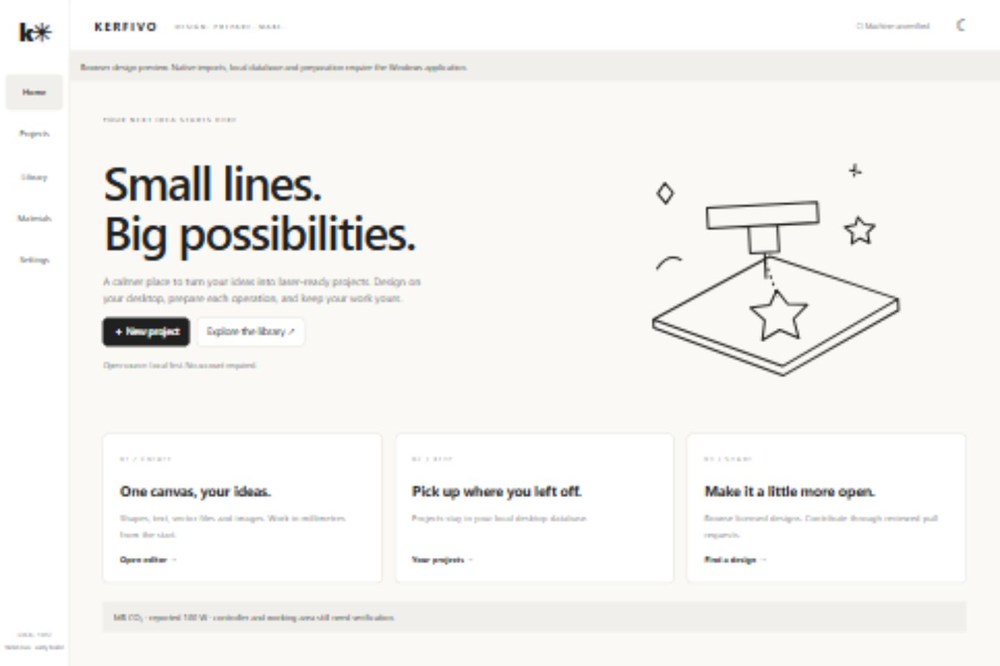

# Kerfivo — local-first laser workspace

Kerfivo is an open-source Windows desktop project using **Rust + Tauri 2**, **Vue/TypeScript**, and **SQLite**. It is designed around a guided workpiece → design → process → preview → positioning workflow with monochrome styling, doodles, light/dark modes and optional red.

This repository's initial publication contains the researched specification, design records and three original MIT-licensed SVG designs. Desktop application source is being validated locally; it is not yet a published or commissioned machine-control release. The actual MB controller, bed and power method remain unknown. Live laser commands are disabled.

- [Project documentation](docs/README.md)
- [User and control flows](docs/flows.md)
- [Current wireframes](docs/wireframes.md)
- [Luban/CorelLaser feature comparison](docs/feature-comparison.md)
- [Implementation issues](https://github.com/NAVANEETHVVINOD/kerfivo/issues)
- [Contribution and license requirements](CONTRIBUTING.md)

The local implementation includes native project storage, bounded SVG/DXF/PNG/JPEG imports, image processing and prepared geometry. Local tests and browser UI checks do not substitute for native Windows acceptance or supervised machine commissioning. Current evidence and limitations are in [the development record](docs/development.md).

The public library uses reviewed catalog changes through GitHub pull requests and local caching, without paid hosting. Downloadable originals: [maker badge](catalog/assets/maker-badge.svg), [circle ornament](catalog/assets/circle-ornament.svg), [minimal tag](catalog/assets/minimal-tag.svg). These contain no approved laser settings.

Original project code and documentation are MIT. Each catalog asset retains its own declared rights and attribution; a repository license does not relicense third-party designs. Kerfivo remains the working name while the proposed Trazer name is evaluated; Trazer already has existing product and domain usage.
