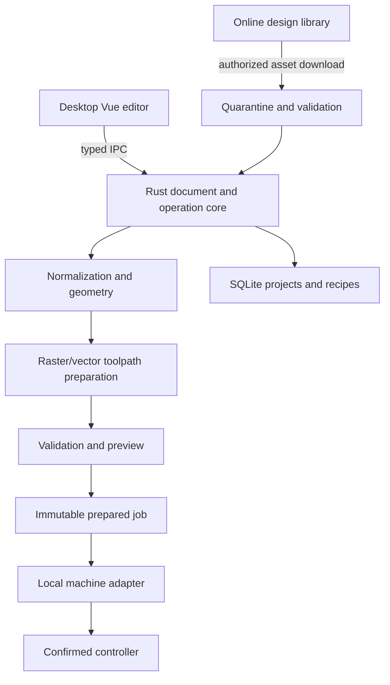

# Proposed architecture

Recommendation for the confirmed Windows scope: Vue 3 + TypeScript + Vite within Tauri 2, Rust domain/job engine, SQLite local storage. The user wants a public, contributable library with zero budget and local operation. Use a GitHub-backed versioned catalog and local assets/cache first; no paid backend or separate hosted login service is required. Reuse frontend components if a static library website is later published. Do not expose remote machine-control endpoints.

## Document and operations

Use a versioned document in millimetres with objects, stable IDs, transforms, groups, text/assets and an explicit operation list. An object's display color is distinct from its operation. Color mapping can assist legacy imports, but operators confirm it. Store the editable document separately from a normalized machining representation.

Normalize SVG units/viewBox/transforms and text appearance explicitly. Curves need a bounded flattening tolerance relative to job scale; stroked paths, filled regions, clips and embedded images have different semantics. Reject unsupported constructs instead of silently dropping artwork. Avoid relying on Fabric serialization as the only project format; choose an editor rendering library after round-trip fidelity prototypes.

A cut containment graph enforces inner-before-outer order; travel optimization cannot break it. Kerf compensation uses a measured recipe value and declared inside/outside/on-path intent. Warn on open contours, duplicate paths, self-intersections, collapsed offsets and unsupported combinations. Raster preprocessing explicitly selects resolution/dithering and overscan allowance.

## Prepared job and control

A prepared job freezes document revision, artwork hashes, coordinate transform/origin, operations, geometry tolerances, recipe revision, machine/controller profile and adapter version. Editing any relevant input invalidates preparation. Start requires current validation, valid position state and confirmation by the local operator.

Capabilities are data: programmable power, homing, framing mode, pause/resume, abort, status telemetry, trustworthy position and recoverability. Unsupported actions return a clear error rather than fake success. The adapter contract is a proposed internal design, not an API copied from an existing crate.

Separate connect/identify/capabilities, prepare/validate, transmit, status and abort operations. A device profile is chosen from recorded hardware evidence; never infer exact board model from vendor ID alone. Only one local process/adapter owns the device. Block jog during an executing job except controller-specific validated procedures.

For Lihuiyu: retain separate command encoder, EGV import/export container, CRC/payload packetizer, CH341 transport and status/backpressure handling. M2 manual-current instructions are part of the setup. For Ruida: implement an independent adapter/protocol. G-code is another adapter family; sending G-code to an M2 is not a fallback.

Disconnect/crash/power loss changes job state to interrupted/unknown and position trust to unknown. Persist host acknowledgments, but never equate them with physical execution. Software abort is not a physical emergency stop. Hardware interlocks remain independent; the UI must not falsely claim to have read water/lid/exhaust sensors absent telemetry.

## Local and online data

| Entity | Key data |
| --- | --- |
| Project | schema version, objects, assets, operations, document revision |
| Machine profile | confirmed board/bed/origin, capability version, calibration records |
| Material | product/composition/thickness, lab approval and source |
| Recipe revision | machine/lens/material match, speed units, power method/value, passes, raster options, air/focus notes, tester/date/evidence |
| Prepared job / run | immutable input hash, adapter/profile revision, transfer log, completion certainty, interruption reason |
| Library asset / revision | owner/visibility, title/tags, dimensions, license/attribution, content hash, revision, preview |
| Cached asset | downloaded revision/hash, license metadata, validation version |

Initial library boundary: a public GitHub catalog manifest plus licensed asset files pinned to a reviewed revision. Browsing/search can happen locally; synchronization downloads a real selected repository revision over HTTPS and checks hashes. Contributions use GitHub pull requests and review. Anonymous public downloads are allowed; GitHub enforces contributor/repository write permissions. Private lab projects and tested recipes stay local and are never uploaded implicitly. Online designs and material recipes are different entities; a download cannot silently apply a foreign machine recipe.

Specify a versioned catalog schema: title, stable ID, tags/categories, format, physical dimensions/unit interpretation, source URL, creator, per-file license/attribution, SHA-256 and revision. Reject unclear redistribution rights; do not scrape and republish arbitrary “free” designs. Contributions add assets/metadata through reviewed PRs. Offline caching uses real storage and integrity checks. If an in-app upload service is added later, select its real auth/storage and enforce server-side authorization; do not simulate it.

## Security and delivery constraints

Imported SVG/image/font files are untrusted. Limit bytes, dimensions, object count, decoding work and memory; disable active content and external resource resolution; generate isolated thumbnails. Do not render arbitrary library SVG directly in a privileged Tauri webview. Tauri capabilities/CSP allow only required IPC/filesystem access; no remote web content receives hardware permissions. Tokens use supported OS storage; no secrets in project files or cloud assets.

Pin dependencies and reviewed references; maintain license attribution and vulnerability checks. Real local acceptance journeys are required before application pushes. Hosted CI must be observed on the actual pushed revision. A simulator is useful unit/integration infrastructure but does not count as physical hardware acceptance or live hosted-library E2E.
