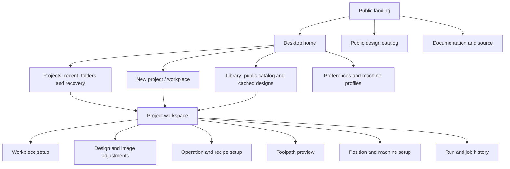
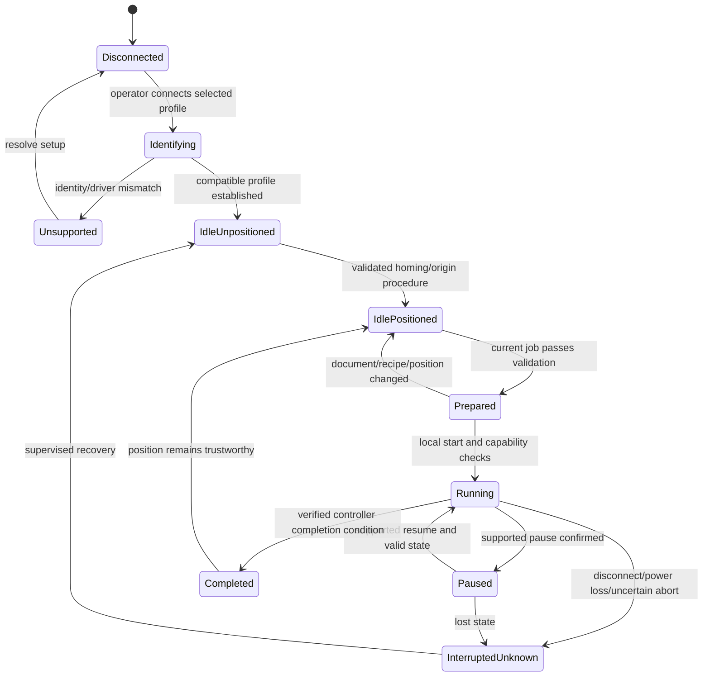

# Kerfivo user and control flows

User steering on 4 October 2026: a guided, approachable Luban-like application rather than a crowded Corel-style editor. Required design includes a landing page, home/project dashboard, different projects, workpiece/job setup, image brightness/contrast, standard/custom shapes, material-based process configuration, engraving/cutting modes, origin and head controls. Visual direction is black/white minimalist with doodles, light/dark themes and optional red accent.

These are planned UX contracts and wireframes, not released application features. Machine controller/bed/power/Z remain unverified.

## Sitemap

Landing is public product information. Home is the local application dashboard. The same branding does not give the public webpage any machine permissions. No account is needed for local editing or public catalog browsing; GitHub handles proposed catalog contributions. Public artwork licenses remain visible.

## Main user journey

```mermaid
flowchart LR
  A[Open/create project] --> B[Set workpiece and material]
  B --> C[Import/draw and arrange]
  C --> D[Assign operations]
  D --> E[Choose verified recipe or calibrate]
  E --> F[Preview and resolve issues]
  F --> G[Set origin / position and frame]
  G --> H[Local operator review]
  H --> I[Start validated job]
  I --> J[Save run result and project]
```

The operator can revisit any preparation step. Status badges distinguish required, complete and needs-review. Navigation never silently recalculates physical origin or starts a machine. Project setup stores workpiece dimensions separately from confirmed machine bed dimensions; a small workpiece is not a smaller machine bed.

### Editing a photograph

Import PNG/JPEG → crop/resize → brightness/contrast → invert if required → choose monochrome threshold/dither or supported grayscale method → inspect the processed preview at the intended engraving resolution → assign a raster operation → choose machine/material recipe → inspect scan directions/overscan/bounds.

Image processing preserves original pixels and editable adjustment parameters. Bitmap dithering controls pixel conversion. Line-fill versus discrete dot-fill/dwell controls motion and exposure; they are separate choices. The current binary-raster prototype uses line scans. Distinct dot-dwell needs its own planner and verified adapter. Vector line engraving follows paths; it is not the same as raster image processing. Cut uses closed outlines where appropriate. Unsupported grayscale/PPI/pulse modes are unavailable, with a plain explanation.

### Public design workflow

Browse/search category → inspect preview, physical dimensions, author, license and revision → download/import a specific reviewed revision → adjust to local workpiece → assign local operations/recipe → preview. Downloading a design never auto-starts or silently applies remote power settings. Contributions link to a GitHub pull request with file/metadata/license requirements. The app works from cached/local catalog files without a paid service.

### Project workflows

New project creates an explicit editable document, not an anonymous process buffer. Home distinguishes recent projects, named projects and interrupted-run drafts. Projects support rename, duplicate, local folders, export and reopen; destructive deletion needs recoverability/confirmation. Future sync does not publish a local project by default. Example projects in the wireframe are clearly labelled demonstrations.

## Control and state flow

Exact control semantics are adapter-specific. The production state model must distinguish sent, accepted, queued and confirmed complete. On controllers without trustworthy telemetry, use qualified labels such as “transfer complete” or “estimated position”; do not imply physical completion. Idle position may become unknown after controller reset or manual motion.

Control enabling rules:

| Action | Preconditions / user-visible behavior |
| --- | --- |
| Home | Identified controller, known homing method and supported axis; disabled if unverified |
| Jog X/Y | Connected supported controller, idle state, valid coordinate strategy and bounds checks |
| Jog Z / autofocus | Actual supported axis/wiring verified; hide/disable otherwise |
| Set job origin | Explicit job anchor plus actual coordinate method; distinguish software job offset from moving the head |
| Frame | Valid bounds and supported laser-off/red-dot framing procedure; never assume a red dot exists |
| Edit power | Programmable controller: validated range/units; manual controller: instruct operator to set current safely |
| Start | Identified profile, current prepared job, resolved issues, valid origin, verified recipe/conditions and local operator |
| Pause/resume | Verified adapter capability and controller acknowledgment; not merely a stopped host queue |
| Stop/abort | Verified behavior and latency; physical emergency stop remains independent |
| Resume after outage | Disabled until a demonstrated recovery capability; uncertainty requires re-positioning and supervised restart |

## Layout and product modes

Guided mode shows the current step, its purpose, essential fields and one next action. Advanced mode expands geometry/process/device settings without changing the document format or bypassing validation. Keep objects and processes separate; selection in one panel highlights the related item in the other.

Design stage: large workspace, compact labelled tools, objects sidebar, right inspector. Process stage: material/recipe strip and ordered operation cards, with advanced fields expanded only as needed. Preview stage: large path view, ordered timeline and issue list. Position stage: bed/workpiece/anchor diagram and capability-gated local controls. Run stage: confirmed state, progress certainty, operation summary and pause/stop controls.

Black/white tokens use strong contrast. Doodles decorate empty states and the landing page, not critical path geometry or warning indicators. Optional red accent is for selected brand/primary action treatment; warnings also use text/icons and remain understandable with monochrome mode. Light/dark theme applies to chrome; artwork preview backgrounds can be independently selected to inspect black/white art.

Required design states: empty projects, unsupported import, unsaved document, loading/failed catalog, offline cache, missing recipe, unknown controller, out-of-bounds workpiece/artwork, unsupported Z/power, preview invalidated, interrupted/unknown run and honest recovery guidance. Keyboard navigation, focus, labels and shortcut discoverability are acceptance criteria.
