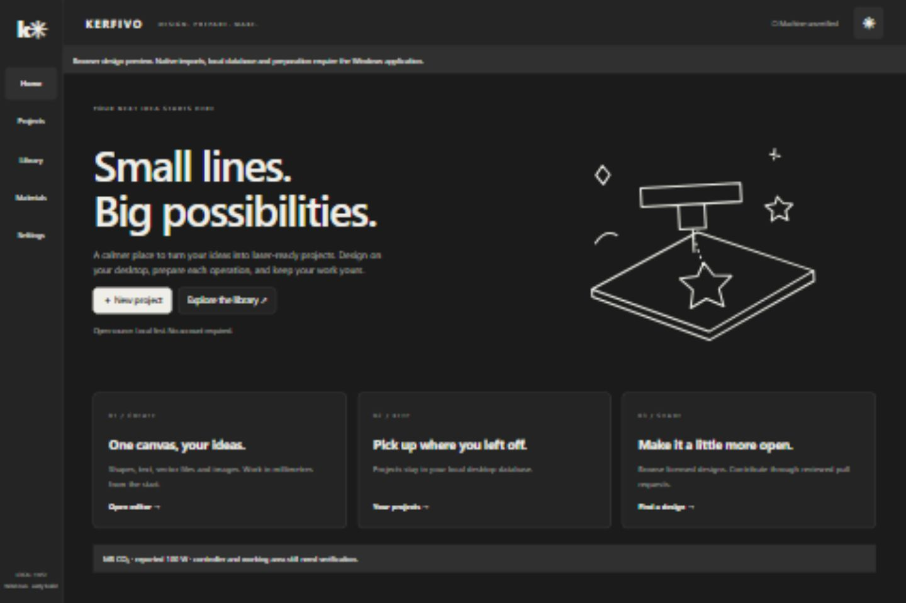
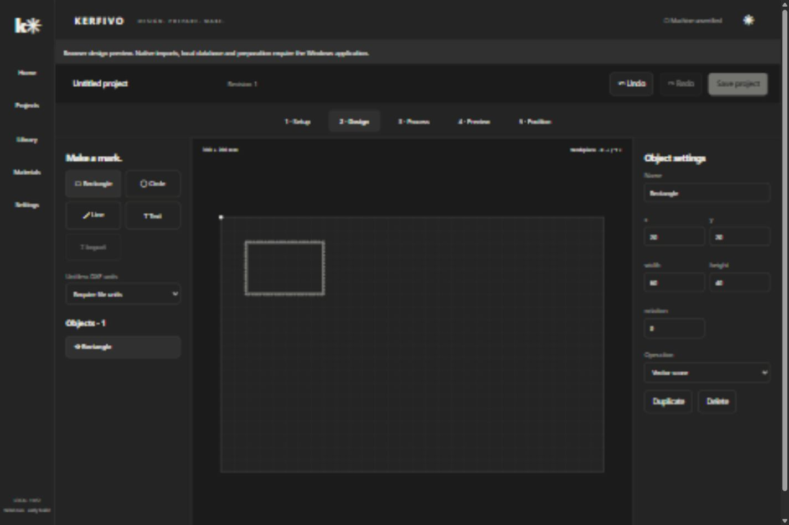

# Desktop wireframes and screen contracts

These captures show the actual Vue interface rendered in the browser at the planned 1440 × 960 desktop window size. They are not proof of native IPC, Windows installation or machine operation. The earlier orange HTML concept is superseded visually by this monochrome direction.

## Home / landing direction




The desktop Home prioritizes New Project, recent/local projects and licensed library discovery. A future public landing page can reuse the illustration, product explanation, source/docs links and real release downloads once available. It must not display a fabricated installer download or machine-compatibility promise.

## Project workspace



```text
┌───────────┬─────────────────────────────────────────────────────────┐
│ App       │ Project name / revision / Undo / Redo / local Save      │
│ navigation├─────────────────────────────────────────────────────────┤
│           │ Setup → Design → Process → Preview → Position          │
│           ├──────────────┬───────────────────────┬──────────────────┤
│ Home      │ Stage tools  │ Workpiece canvas      │ Object inspector │
│ Projects  │ Objects or   │ millimetres, X→ Y↓    │ XY, size, rotate │
│ Library   │ ordered      │ artwork or prepared   │ image parameters │
│ Materials │ operations   │ geometry              │ or review issues │
│ Settings  │ Next action  │                       │ operation choice │
└───────────┴──────────────┴───────────────────────┴──────────────────┘
```

Setup stores workpiece width/height/thickness/material/anchor separately from actual machine bed. Design has primitives, imported artwork and an inspector; Process displays independent ordered raster/score/cut operations. Preview displays actual prepared paths and actionable issues. Position explains unknown hardware and disables head/start commands.

Projects shows genuine local saved records and an empty state, without seeded fake work. Library shows cached author/license/revision/dimensions and explicit contribution/sync actions. Materials starts empty until the lab approves machine-specific recipes. Settings separates appearance preferences from factual hardware identification.

Required remaining states: unsaved-navigation guard, corruption/recovery, failed/offline sync, unsupported import, out-of-bounds geometry, stale preview, keyboard focus, and unsupported device capabilities. Implementation issues #8–18 cover the remaining slices. [Full user/control flow](flows.md) defines eventual running/interrupted states; they are not available in this offline pilot.
